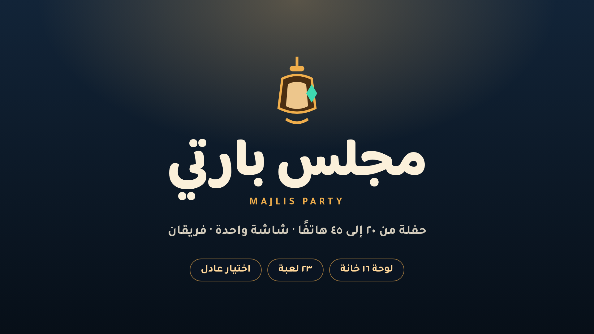

# Majlis Party v2 — مجلس بارتي

A standalone projector party game: one big screen, **20–45 phones**, **two teams** (الفيروز mint / الرمان coral),
a **board of sixteen spaces between every minigame**, and a golden-dallah count that decides the night.

No shared code, art, camera or characters with ND96 — this repo is the whole game, on its own port (9520).



## What is new in v2

| Area | v2 |
|---|---|
| Identity | **Lantern Night**: a night majlis diorama — pomegranate rug, plaster wall with a brass arch, two strings of lanterns, a ring of cushions. Mint/coral, cream type. |
| The party game | A 16-space **rug road** after every round: dice, coins, golden dallahs, shop, chaos, event, and a **fork the phones vote on**. |
| Turn picker | One pool per session from `lib/picker.js`: everyone plays once before anyone repeats, pairs always span both teams, random inside the pool. Tested with 45 bots. |
| Session length | Chosen in the lobby: **قصيرة · ٥ جولات** or **كاملة · ٩ جولات**. |
| Watching phones | A phone with nothing to press gets a **cheer button** — never a dead screen. |
| Rig | One instanced character (thobe, arms, painted face, ghutra, iqal, team scarf) used for the lobby crowd, the board tokens and the podium. |

## Run it

```bash
npm install
PORT=9520 ADMIN_KEY=9632 JOIN_CODE=2468 node server.js
# a public URL for phones:
cloudflared tunnel --url http://127.0.0.1:9520
```

| Route | Who | What |
|---|---|---|
| `/` | guests | landing page with QR + join code |
| `/host` | projector | the show: lobby QR, wheel, arenas, **board**, results, finale |
| `/play` | phones | the one pad page every minigame uses |
| `/admin` | host phone | start, pause, skip, session length, points, AFK, kick |
| `/api/state`, `/api/games` | tooling | JSON state and the minigame list |

Tooling:

```bash
node tests/run.js                                   # all gates
node tools/loadtest.js --bots 45 --start --key 9632 # 45 real socket clients
node tools/scene-shots.js --bots 45 --key 9632      # 1920×1080 review frames
node tools/admin.js session short --key 9632        # shell admin
bash docs/film/build.sh <capture.mp4> out.mp4       # the 90 s film
```

## The flow

`lobby → wheel → [slot] → announce → countdown → playing → results → board → … → final`

* The **wheel** draws the next minigame (no repeat inside the last four draws).
* The **board** runs after every result: the round's winner rolls two dice and keeps the best, the other team
  rolls one; both walk the road. Spaces: coin, golden dallah, shop (10 coins = 1 dallah), chaos, event, and a
  **fork** (the phones vote: 3 spaces −2 coins, or 5 spaces).
* The **finale** ranks by golden dallahs, then coins, then points. Points only buy better dice.
* Every drawn pair spans both teams, and the party is two teams by design.

## Design notes

`docs/DESIGN.md` holds the identity and the reasons (why "Lantern Night" and not neon, how the board is drawn,
what the picker promises). `public/board-path.js` owns the sixteen spaces — picture and rules read the same file,
so they can never disagree.

## Tests

| Gate | Promise |
|---|---|
| `tests/board.test.js` | 16 fair spaces, no backwards moves, no negative coins, the shop's ten coins, majority forks, and a picker that covers 45 players |
| `tests/sim.test.js` | every minigame completes with 45 bots |
| `tests/pad-sync.test.js` | every live round gives its players a control on the same tick |
| `tests/dom-stability.test.js` | 30 s of live ticks with no node churn outside phase changes |

## Credits

* Type: **Baloo Bhaijaan 2** and **Tajawal** (SIL Open Font License).
* Music in the film: *"Middle Eastern Mystique With Bright Strings"* by Alex Morgan — **CC BY 4.0**
  ([Free Music Archive](https://freemusicarchive.org/music/alex-morgan/folk-world/middle-eastern-mystique-with-bright-strings/)).
* The set, rig and all minigame props are built in code (`public/party-art.js`, `public/host-scene.js`).
